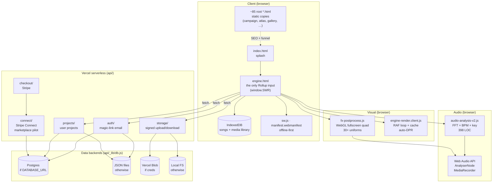
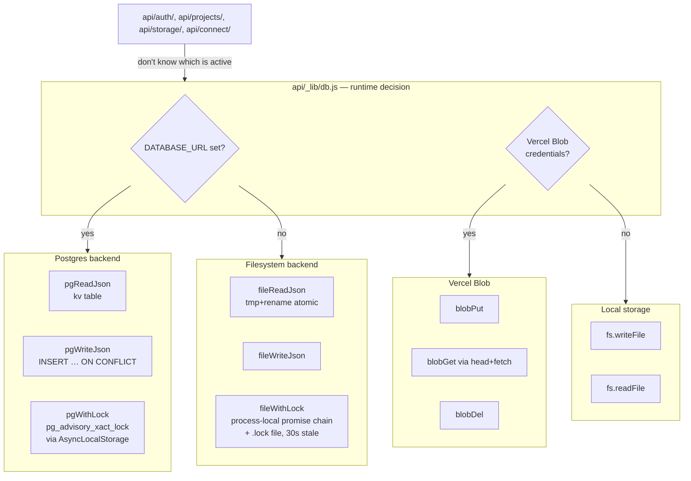

# Sainted Word Records — A One-Person Browser-Native Video Engine

> A reading of [`kajica2/sainted-word-records`](https://github.com/kajica2/sainted-word-records) (0★, MIT, single-author). Live: [sainted-word-records.vercel.app](https://sainted-word-records.vercel.app/).
> ~3,538 files. ~50K LOC of JS/ESM. ~1,629 markdown docs. 86 HTML pages. 100+ unit/smoke/verify test scripts. One Vite build, one Rollup input, full Stripe + Postgres + Vercel Blob backend.

## Table of contents

1. [What this product is](#1-what-this-product-is)
2. [The big architectural decisions](#2-the-big-architectural-decisions)
3. [The audio engine: hand-rolled DSP in 400 lines](#3-the-audio-engine-hand-rolled-dsp-in-400-lines)
4. [The visual engine: WebGL fullscreen-quad post-process](#4-the-visual-engine-webgl-fullscreen-quad-post-process)
5. [The render layer: cache, auto-DPR, and the 60fps pursuit](#5-the-render-layer-cache-auto-dpr-and-the-60fps-pursuit)
6. [The data layer: a textbook adapter over Postgres/JSON + Vercel Blob/FS](#6-the-data-layer-a-textbook-adapter-over-postgresjson--vercel-blobfs)
7. [The site: 86 HTML pages, one Rollup input, 100+ test scripts](#7-the-site-86-html-pages-one-rollup-input-100-test-scripts)
8. [The global-IIFE-on-window pattern](#8-the-global-iife-on-window-pattern)
9. [What I'd steal, what I'd change](#9-what-id-steal-what-id-change)
10. [Appendix: coverage & file map](#10-appendix)

---

## 1. What this product is

Sainted Word Records (SWR) is a browser-native audio-reactive video engine wrapped in a tiny SaaS business. Drop in an MP3, drop in a folder of clips/images/GIFs, hit play. The engine analyses the audio (BPM, key, beats, onsets, chromagram) and renders a real-time reactive composition. Click REC, get a WebM out. No upload, no server render, no SaaS fees. The whole pipeline runs locally in the browser.

Three product tiers are bolted onto the same engine:

- **Free** — engine, watermarked
- **Personal Tier (PT)** — €120/€280/€600 one-time, credit-bank model (not subscription)
- **Service** — €25/€45/€75 per curated render delivered in 48h

The stack is the interesting part. It's *exactly* the minimum viable set for a single-developer production app:

| Layer | Choice | Why |
|-------|--------|-----|
| Build | Vite (5.4) | One Rollup input, 85 static HTML pages copied verbatim |
| Audio DSP | Hand-rolled in JS, zero deps | Web Audio API + 400-line FFT/BPM/key module |
| Visual | WebGL fragment shader, fullscreen quad | 30+ uniforms, audio-reactive |
| Rendering | `MediaRecorder` + `OffscreenCanvas` | Pure browser, no FFmpeg |
| Persistence (client) | IndexedDB | Audio + media library persist across reloads |
| Auth | Magic-link email | No passwords, no third-party auth |
| DB | Postgres (prod) or local JSON files (dev/test) | Same adapter for both |
| Storage | Vercel Blob (prod) or local FS (dev) | Same adapter for both |
| Payments | Stripe (Checkout + Connect for marketplace pilot) | Per-credit model |
| Email | Nodemailer / SMTP | Magic links, receipts |
| Tests | `node --test` (verify scripts) | 100+ npm scripts for unit/smoke/verify |
| Deploy | Vercel + Hugging Face Space | Multi-platform from one source |

The comments in this codebase are exceptional. Not in the "well-documented" sense — in the sense that the engineer explicitly narrates *why* decisions were made, often in the form of "this used to be X, it was wrong, here is why we did Y." This is a project that audits itself.

### System architecture



The audio analysis and visual post-process live entirely in the browser. The serverless API is thin — auth, storage, projects, payments. The data layer is an adapter that picks Postgres/JSON at module load, and Vercel Blob/local-FS independently.

### Audio → Visual data flow

```mermaid
flowchart LR
  Buf[AudioBuffer<br/>user's song] --> AA[AudioAnalysisV2.analyzeBuffer]
  AA -->|once| Features[features = bpm, key,<br/>scale, chromagram, onsets]
  Features -->|stored on state| Bus[SWR.fx / window.SWR]
  Bus -->|u_bass, u_mid, u_treble,<br/>u_beat per frame| Shader[fx-postprocess.js<br/>WebGL fragment shader]
  Shader -->|u_mut, u_mutAlgo,<br/>u_liquid, u_pearl, u_glitch| Composited[composited output]
  Composited -->|recorded| WebM[MediaRecorder →<br/>download .webm]
```



The same scalar features drive *both* the one-time analysis result (BPM/key/chromagram, used for the static persona picker) and the per-frame uniforms (bass/mid/treble/beat, used to modulate the visual). The audio side produces a result once; the visual side consumes the per-frame slice continuously. Two consumers, one producer.

---

## 2. The big architectural decisions

Five decisions shape everything else.

### 2.1 One Rollup input, ~85 static pages

`vite.config.js` registers exactly one HTML file as a Rollup input: `engine.html`. Every other page (`index.html`, `landing.html`, `campaign.html`, `about.html`, `404.html`, `atlas-*.html`, `versions/*.html`, etc.) is copied verbatim to `dist/` by a custom Vite plugin. From the AGENTS.md:

> `engine.html` — main engine, served at `/engine/` (the PWA entrypoint). It is the **only** Rollup input in `vite.config.js`; every other page ships as a static copy.

This is a *brilliant* call for a single-developer project. The engine is a real SPA with module graph, hot reload, code splitting. The marketing/landing surface is 85 static HTML files that need to be fast, SEO-friendly, and individually testable. By keeping them out of the Rollup graph, the build stays fast, the static pages don't pull in the engine's dependencies, and you can ship a copy update to one landing page without rebuilding the whole bundle.

The mechanism: `vite.config.js` reads `site-map.json` (a hand-maintained JSON file of every page) to generate the list of files to copy. The build is data-driven by a single source of truth. Edit `site-map.json` → rebuild → new page is live.

### 2.2 The "global IIFE on window" pattern

Every client-side module is an IIFE that attaches exactly one uppercase global:

```js
// audio-analysis-v2.js
window.AudioAnalysisV2 = { analyzeBuffer, startLive, ... };

// fx-postprocess.js
window.FX = { state, setPersona, setTone, ... };

// engine-render.client.js
window.SWR_RENDER = { fit, frame, setAutoDpr, ... };
```

Pages then `defer`-load these scripts in order and read the globals. No ES module imports, no CommonJS, no bundler magic. The whole client is a chain of `defer` tags in HTML files. This works because:

1. Every page is a single HTML with explicit script tags — there's no module-graph discovery needed.
2. The scripts are independent and don't import each other (they communicate through shared `window.*` objects, often deliberately).
3. The 400-line audio module, the 800-line WebGL module, and the 660-line render module are all standalone files you can `grep` and reason about in isolation.

The cost: no tree-shaking, no code-splitting, no import-graph-based analysis. The benefit: every module is a 30-second read.

### 2.3 Backend adapters that select at module load

`api/_lib/db.js` is the cleanest example I've seen of an adapter pattern over serverless primitives. The whole 1,000-line file has *one* runtime decision — `USE_PG = !!DATABASE_URL` — made at the top:

```js
const withLock    = USE_PG ? pgWithLock    : fileWithLock;
const readJson    = USE_PG ? pgReadJson    : fileReadJson;
const writeJson   = USE_PG ? pgWriteJson   : fileWriteJson;
const deleteJson  = USE_PG ? pgDeleteJson  : fileDeleteJson;
```

Every call site (`createUser`, `getProject`, `recordConnectEvent`, ...) goes through the adapter and doesn't know which backend is active. The same applies to the storage adapter (Vercel Blob vs local FS) and the OAuth credential adapter (resolveBlobCredentials, which handles the case-sensitivity nightmare of Vercel's "Connect Project" prefix).

The `withLock` story is the deepest part. On local FS, it's a process-local promise chain. On Postgres, it's `pg_advisory_xact_lock` inside a transaction, with the client propagated through `AsyncLocalStorage` so the read-modify-write pair runs on the same connection. The comment is worth quoting in full:

> The previous lock was a process-local promise chain plus a `.lock` file — it serialises within ONE warm instance only. Two concurrent requests landing on different instances could both read users.json, each append a user, and the second write would drop the first. That race exists today, independent of cold starts.
>
> Here, withLock() opens a transaction and takes pg_advisory_xact_lock(), which is held for the transaction and released automatically on COMMIT/ROLLBACK. That is a genuine cross-instance mutex with no TTL to tune and no stale-lock path.

This is the kind of comment that tells you the author has actually debugged the problem, not imagined it.

### 2.4 The audio engine and visual engine are decoupled

The 400-line `audio-analysis-v2.js` produces `{ bpm, key, scale, confidence, chromagram, onsets, duration }`. The 800-line `fx-postprocess.js` accepts `u_bass`, `u_mid`, `u_treble`, `u_beat`, plus 15 persona uniforms. **The two communicate only through these scalar uniforms.** Neither knows the other's internal state.

This is the right shape: the audio side evolves (better BPM, more onsets, multi-band analysis), the visual side evolves (new mutation algorithm, new filter), and the contract is a 4-5 number tuple per frame. You can rewrite either side without touching the other.

### 2.5 The "shipped as opt-in is shipped dead" comment

This is the most quoted-worthy observation in the codebase, from `engine-render.client.js`:

> The default was off in the initial commit but the integration reviewer flagged that the feature ships dead as opt-in — mobile users (the target audience) never enable it manually.

The auto-DPR feature (which steps rendering DPR down on slow devices to hold 60fps) was originally opt-in. A reviewer caught that the *target audience* (mobile users) would never enable it. It got flipped to default-on. **The project audits its own UX decisions in code comments.** If you're a single developer and you don't have a team reviewing PRs, you write the review into the code.

---

## 3. The audio engine: hand-rolled DSP in 400 lines

`audio-analysis-v2.js` is 398 lines. It produces all the audio features the rest of the engine depends on. No dependencies. No Web Audio magic (it consumes an `AudioBuffer` and produces a result object). 100% portable — you can paste it into a Node script and it'll work.

The five components:

### 3.1 Cooley-Tukey FFT (lines 48-82)

In-place radix-2, bit-reversal permutation, butterfly loops. Standard textbook. The interesting bit is the *caching* of the Hann window and the real/imag buffers per FFT size:

```js
const _winCache = new Map();
function hannWindow(N) {
  let w = _winCache.get(N);
  if (w) return w;
  w = new Float32Array(N);
  for (let i = 0; i < N; i++) w[i] = 0.5 * (1 - Math.cos((2 * Math.PI * i) / (N - 1)));
  _winCache.set(N, w);
  return w;
}
```

For an FFT size of 4096, the Hann window is 16 KB of Float32. Without caching, every call to `computeMagnitudes` allocates 16 KB. With caching, it allocates once. The same goes for the real/imag scratch buffers. The comment notes that live analysis (`startLive`) doesn't even call this — but batch analysis (analysing a preset's worth of songs back-to-back) does, so the caching matters.

### 3.2 Chromagram (lines 107-132)

Takes FFT magnitudes (half-spectrum, length = fftSize/2), bins them into 12 pitch classes (C, C#, D, ..., B) using `12 * log2(freq/440)` to map frequency → chroma. Reference A4 = 440 Hz. Frequency range 27.5 Hz (A0) to 4186 Hz (C8). Output is peak-normalized to 0..1.

Standard textbook chromagram. The Krumhansl-Schmuckler key profiles that consume it (below) need peak-normalized input, hence the `max > 0` guard.

### 3.3 BPM estimation (lines 176-220) — the most interesting

The function `estimateBPM(onsetTimes)` is the *most commented* part of the file. Three properties of real recordings it has to get right, with a paragraph each explaining what the previous version did wrong and why:

1. **JITTER.** Human performance and onset-detection error scatter inter-onset intervals by ~20-30ms. Binning at 10ms and demanding 50% in one bin means any real material fails and returns 0. The old behavior: `240ms ±5ms` → 125 BPM, but `240ms ±15ms` → 0. The fix: score candidates over a 10% tolerance window, not a single bin.

2. **OCTAVE.** Onsets at 120ms and 240ms both mean ~125 BPM (500/2 and 250/2). Histogramming raw intervals makes them separate peaks that each fail the confidence floor. The fix: fold each candidate into 60-180 BPM *before* histogramming.

3. **DENSE ONSETS.** The old 0.2s interval floor discarded anything faster than 300 BPM before the fold. The fix: since the fold maps any tempo into range, the floor only needs to reject double-triggers (75ms ≈ 800 BPM is too fast to be real), not fast material.

This is what a real DSP implementation looks like. Not "compute autocorrelation and return the peak" — a hand-tuned histogram with documented failure modes, jitter tolerance, and an honest "I don't know" return value when the confidence floor isn't met.

### 3.4 Key detection (lines 222-262)

Krumhansl-Schmuckler key profiles. Two 12-element templates: one for major, one for minor. For each of the 12 keys, rotate the template so it lines up with the chroma, then compute Pearson correlation. The best score wins. Confidence is the raw correlation.

```js
const MAJOR_PROFILE = [6.35, 2.23, 3.48, 2.33, 4.38, 4.09, 2.52, 5.19, 2.39, 3.66, 2.29, 2.88];
const MINOR_PROFILE = [6.33, 2.68, 3.52, 5.38, 2.60, 3.53, 2.54, 4.75, 3.98, 2.69, 3.34, 3.17];
```

These numbers are the *output* of an empirical study from 1990 (Krumhansl & Schmuckler) asking listeners to rate how well each pitch class fit a tonic. They're the standard "what does major sound like in the abstract" baseline.

### 3.5 Onset detection (lines 264-306)

Energy-based, not spectral-flux. 20ms window, 10ms hop. Compute the half-wave-rectified difference of energy between consecutive frames (the "flux"). Adaptive threshold: 1.5× the local mean + tiny epsilon. Local peak picking. 200ms minimum gap between onsets.

The whole pipeline is offline (one-shot per buffer) plus a live mode (`startLive`) that uses Web Audio's `AnalyserNode` and emits chroma + key every 100ms. Same code, two execution contexts.

---

## 4. The visual engine: WebGL fullscreen-quad post-process

`fx-postprocess.js` is 800 lines. The "engine" is a single fullscreen quad — two triangles covering the screen — that reads from a `sampler2D` (the composited stage canvas) and writes to `#fx-canvas`. The fragment shader is the heart of the visual pipeline.

The uniforms (audio-reactive):

| Uniform | Source | What it does |
|---------|--------|--------------|
| `u_bass`, `u_mid`, `u_treble` | audio bands | Drive mutation strength, vignette, grain |
| `u_beat` | onset envelope | Multiplicative brightness pulse |
| `u_time` | RAF timestamp | All time-based effects |
| `u_temp` | temperature slider | Warm/cool color tint |
| `u_tone` | tone slider | Desaturation + warm/cool split-tone grade |
| `u_mut` | mutation amount | 0..1 strength of selected mutation |
| `u_mutAlgo` | mutation algorithm | 0=vortex, 1=glitch, 2=liquid, 3=kaleidoscope, 4=ripple, 5=chromatic noise |

The persona uniforms (preset-driven, 11 of them):

| Uniform | What it does |
|---------|--------------|
| `u_posterize` | Color quantization (256 levels → 3 levels) |
| `u_vignette` | Radial dark mask |
| `u_chroma` | Chromatic aberration (per-channel UV split) |
| `u_grain` | Film grain |
| `u_sepia` | Warm brown monochrome |
| `u_glow` | Bloom (4-neighbor sample, added back) |
| `u_grayscale` | Desaturation (L = 0.299R + 0.587G + 0.114B) |
| `u_blur` | 3×3 weighted box sample |
| `u_liquid` | FBM domain warp |
| `u_pearl` | Voronoi cell displacement + edge highlight |
| `u_glitch` | 60-row horizontal slice displacement at 12Hz, hash-gated |

The mutation dispatch is a clean switch-on-integer in GLSL:

```glsl
vec2 mutate(vec2 uv, float t, float amt, float algo) {
  if (amt < 0.001) return uv;
  vec2 off = vec2(0.0);
  float a = floor(algo + 0.5);
  if (a < 0.5) { /* vortex */ }
  else if (a < 1.5) { /* glitch */ }
  else if (a < 2.5) { /* liquid fbm warp */ }
  else if (a < 3.5) { /* kaleidoscope */ }
  else if (a < 4.5) { /* ripple */ }
  else { /* chromatic fbm */ }
  return uv + off;
}
```

The procedural primitives are all in-file and tiny: `hash`, `noise`, `fbm` (4 octaves of value noise), `voronoi` (animated cell distance). No textures, no LUTs, no asset loading. The whole effect graph is GLSL strings concatenated at startup.

The fragment shader is exposed as `window.FX_FRAG_SOURCE` so `persona-preview.client.js` (which renders preview thumbnails) can compile the *same* shader and stay in sync with the live pipeline. This is the same pattern as Linguist's `samples_data.rb` — one source of truth for the policy, multiple consumers.

### 4.1 The intensity slider is render-time only

A really nice detail: the master FX intensity (`FX.intensity`, 0..1) is a *render-time multiplier*. It is never written into `FX.state`. The state holds the *base* values; the render applies the multiplier each frame. This means presets with `intensity=0.5` and `intensity=1.0` produce the *same* state hash, the same preset ID, the same persistence — but render differently. The multiplier is a temporary user override that doesn't pollute the saved state.

The comment in AGENTS.md makes this explicit:

> Honours the master `FX.intensity` multiplier (0–1, render-time only — never written into state) exposed by `lib/intensity-slider.client.js` and persisted via `swr.fx.intensity`.

Same for `u_tone`: the tone slider drives `u_tone` directly to the shader, the shader honors it, but `FX.state.tone` is not the source of the slider's value. The slider writes through to the shader; the state stores the *user's choice*, not the *current frame's value*.

---

## 5. The render layer: cache, auto-DPR, and the 60fps pursuit

`engine-render.client.js` is 660 lines. It's a *renderer for canvas-based engine pages* — a per-frame RAF loop that composes a stack of layers, runs the FX post-process, and renders the meter.

### 5.1 The cache: offscreen canvas per layer, version-hash invalidated

Each layer's full draw (filter + transform + composite) is rasterized into an offscreen canvas on first use, then blitted as a single `drawImage` on subsequent frames. The cache key is a version hash derived from the layer's `applyR()` result and asset id. When either changes, the next frame redraws.

```js
// Cap on cached entries. Each entry holds a full backing-store canvas
// (~16.6 MB at the DPR-2 default backing store). Without a cap, long
// sessions that swap many layers leak canvases forever. Cap=4 covers
// the visual sweet spot (most engines use 4-8 layers; the rest get
// redrawn uncached each frame, which is fine because the per-layer
// draw is fast for uncached entries). Worst-case GPU memory drops
// from ~266 MB to ~66 MB.
cacheCap: 4,
```

The "active" set (top N by audio energy) is *never* cached. Animated layers always redraw. The static layers cache aggressively. **The cache is bypassed precisely when caching would be wrong** (live motion), and used precisely when caching is right (static composition). This is the rule of caches, stated as code.

### 5.2 Auto-DPR with conservative thresholds

`autoAdjustDpr(frameMs)` runs on every RAF. It keeps a rolling 60-frame sample of render times. With a 2-second cooldown (asymmetric: easy to step down, hard to step up), it adjusts DPR:

- If avg frame > 18ms (missing 60fps): step DPR down by 0.25
- If avg frame < 12ms (room to spare): step DPR up by 0.25
- Otherwise: hold

The "hard to step up" asymmetry is the battery cost observation. Stepping up burns battery; stepping down doesn't. The cooldown prevents flapping.

The persistence detail is the gold: the step-down value is written to `localStorage.swr.render.dprAutoLow`, and `devicePixelRatio()` reads it back to *clamp* the natural DPR. Without this, every call to `fit()` would reset to the cap and silently undo the auto-adjustment. The comment calls this out:

> Persist the step-down lower bound so fit()'s next call to devicePixelRatio() returns the auto-chosen value instead of silently resetting to the cap. Without this, the autoDpr feature is a no-op on every device where natural DPR > cap (every iPhone, iPad, and most Android phones since 2018).

This is engineering that has actually been tested on real devices. The author knows that "every iPhone since 2018" is the target audience and ships accordingly.

### 5.3 The fade-stepper hook

```js
// SWR_RENDER.frame() calls SWR_TIMING.step(dt, l, r) once per layer per
// frame before the offscreen draw, replacing r.opacity with the eased
// currentOpacity. The cache key includes the stepped value so a fade-
// in/out does NOT cache a frozen frame. engine-timing.client.js is
// opt-in — if absent, r is passed through unchanged.
```

The cache key includes the *current* opacity, not the *target* opacity. This is the kind of subtle detail that prevents a real bug: if you cache by target opacity, a fade-in layer gets cached at the first frame, then the cache hit for the next 30 frames returns the same first frame, the fade never animates, and the user sees a layer pop in.

The hook is opt-in: pages that don't define `SWR_TIMING` get pass-through behavior. This is the *open/closed principle* applied to a single global function — adding a timing stepper doesn't require modifying the renderer.

---

## 6. The data layer: a textbook adapter over Postgres/JSON + Vercel Blob/FS

`api/_lib/db.js` is 1,050 lines. It's the data layer for the entire M1 backend: auth, sessions, projects, verifications, Stripe Connect, storage. The shape is *one file, one decision* (which backend), thirty call sites that go through the adapter.

### 6.1 The backend decision




```js
const USE_PG = !!DATABASE_URL;
const withLock   = USE_PG ? pgWithLock   : fileWithLock;
const readJson   = USE_PG ? pgReadJson   : fileReadJson;
const writeJson  = USE_PG ? pgWriteJson  : fileWriteJson;
const deleteJson = USE_PG ? pgDeleteJson : fileDeleteJson;
```

Local dev and the test suite get the filesystem backend. Production (Vercel) gets Postgres. The route handlers (`api/auth/*`, `api/projects/*`, etc.) never import `pg` or `node:fs` directly; they call `findUserByEmail`, `createSession`, `upsertProject` and the adapter is invisible to them.

### 6.2 The concurrency model

The filesystem backend uses a process-local promise chain + a `.lock` file with 30s stale-lock TTL. The Postgres backend uses `pg_advisory_xact_lock` inside a `BEGIN/COMMIT` transaction, with the client propagated through `AsyncLocalStorage` so the read-modify-write pair runs on the same connection and sees a consistent snapshot.

The comment on the Postgres lock is a *masterclass* in explaining a concurrency model:

> pg_advisory_xact_lock(), which is held for the transaction and released automatically on COMMIT/ROLLBACK. That is a genuine cross-instance mutex with no TTL to tune and no stale-lock path. The transaction client is propagated to readJson/writeJson via AsyncLocalStorage, so the guarded read-modify-write pair runs on the same connection and sees a consistent snapshot.

The reason for the `AsyncLocalStorage` is non-obvious: `pg`'s pool gives you a client per `pool.connect()` call. If you call `readJson` and `writeJson` separately, you might get different clients and see different transactions. The store propagates the client through `AsyncLocalStorage` so the read happens on the same connection as the write.

### 6.3 The race in `createUser` is handled, but the comment is gold

```js
export async function createUser({ email, ... }) {
  if (!email) throw new Error('email required');
  const existing = await findUserByEmail(email);
  if (existing) {
    // backfill membershipTier on legacy users
    if (!existing.membershipTier) {
      return updateUser(existing.id, { membershipTier: 'free' });
    }
    return existing;
  }
  return withLock(async () => {
    const users = await readJson(USERS_PATH, []);
    // Race branch: another request created this user between the unlocked
    // findUserByEmail() above and this lock acquisition. We are already
    // holding withLock, so update in place here — calling updateUser()
    // would re-enter withLock() and deadlock the single-promise lock chain.
    const existingIdx = users.findIndex(...);
    if (existingIdx !== -1) {
      // ... in-place update, no re-entrant withLock
    }
    // ... actual create
  });
}
```

This is a real bug, identified and worked around in the same function. The author noticed that `createUser` does an unlocked check (`findUserByEmail`) before taking the lock, which means a concurrent request could create the user in the gap. The fix is to re-check inside the lock and *not* call `updateUser` (which would re-enter `withLock` and deadlock the single-promise chain).

This is the right way to write concurrent code: name the race, document the workaround, and make the workaround obvious from reading the function.

### 6.4 The Vercel Blob credentials resolver

Vercel Blob's "Connect Project" dialog sets env vars with a *user-supplied prefix* (BLOB, blob, BLOB2, blob2, ...) and a *case-sensitive* read by `@vercel/blob`. The `resolveBlobCredentials` function handles this:

```js
function rank(prefix, suffix) {
  const digits = suffix ? Number(suffix) || 99 : 0;
  // Bare BLOB/blob outranks BLOB2/blob2; uppercase outranks lowercase.
  const caseRank = /^[A-Z]/.test(prefix) ? 0 : 1;
  return digits * 2 + caseRank;
}
```

It iterates all env vars, parses `<prefix>_READ_WRITE_TOKEN` and `<prefix>_STORE_ID`, validates the token shape, sorts by rank, and returns the highest-ranked credentials. This is the kind of thing you write *once*, after the first time you spend four hours debugging why your deploy silently fell back to local-FS because someone named the prefix `blob` instead of `BLOB`.

### 6.5 The rate limiter is process-local

```js
const rateBuckets = new Map();
export function rateLimit({ key, windowMs = 60_000, max = 60 }) {
  // ... in-memory bucket per key
}
```

A simple in-memory rate limiter. The comment notes this is "per-lambda in prod, per-process in dev." On Vercel serverless, this means each instance has its own limit — a determined attacker can multiply by the instance count. For SWR's scale (early-stage single-developer product), this is fine. For a public-facing API, this would need to be a Postgres-backed sliding window.

---

## 7. The site: 86 HTML pages, one Rollup input, 100+ test scripts

The site is *the* remarkable thing about this codebase. 86 HTML pages. Most of them are *static* — they are HTML files at the root, copied to `dist/` by the Vite plugin, served as files. The engine itself is the only one that gets bundled.

The page families (from AGENTS.md):

- **Marketing/educational:** `landing.html`, `campaign.html`, `personas.html`, `marketplace.html`, `make-video.html`, `intro.html`, `about.html`, `changelog.html`, `press.html`, `status.html`, `thanks.html`, `portfolio.html`, `tutorial-30s.html`, `interactive-howto.html`
- **App surfaces (full-viewport, no shared nav):** `engine.html`, `dashboard.html`, `spit.html`, `make-video.html`, `enhance.html`, `photo.html`, `ar-gif.html`, `tiktok.html`, `swr-app.html`
- **Family prefixes:** `gallery-*` (19), `landing-personas-v*` (6), `atlas-*` (9), `swr-*` (7), `persona-*`, `engine-*`, plus `versions.html`, `spit.html`, `shop.html`, `photo.html`, `packs.html`, `dashboard.html`, etc.
- **System:** `404.html`, `offline.html`

The *page-count as a deliberate design choice* is the insight. The site doesn't try to be a SPA. It's a content site with one full app embedded. The marketing surface has 50+ pages, each one hand-tuned for a specific audience or funnel. The engine is the only thing that needs module bundling. **This is a content-marketing site that happens to have an app, not an app that happens to have marketing.**

### 7.1 The test discipline

`package.json` has 100+ npm scripts for testing. Three categories:

- **Unit tests** (`check:*-unit.mjs`): targeted unit tests for individual modules. ~50 of them.
- **Smoke tests** (`check:*-smoke.mjs`): integration tests that exercise the API or a specific feature. ~20 of them.
- **Verify tests** (`verify:*.mjs`): end-to-end checks — site navigation, page loads, cross-surface integration. ~30 of them.

This is the discipline of a project that has had bugs. Each `verify:*` script is a "this used to break, here's how we know it doesn't anymore" guard.

### 7.2 The vite.config.js is unusual

`vite.config.js` is 873 lines — *huge* for a config file. The reason: it does far more than configure Vite. It implements:

- A Vite plugin to copy ~85 root HTML files to `dist/`, skipping dotfiles, `_candidates/`, `_archive/`, and `data/invite-store/` (privacy)
- A Vite plugin to inline the `targeting/rules.json` as a `<script type="application/json">` tag in `engine.html` for offline-first PWA behavior
- A Vite plugin to inline the per-variant automix config for `versions/*.html`
- A Vite plugin to inline the footer nav from `site-map.json`
- A Vite plugin to generate the dev API proxy

The pattern: *build-time inlining* of runtime data. Anything the engine needs at boot (targeting rules, automix config, footer nav) is inlined as JSON in the HTML at build time. The runtime doesn't need to fetch them. The PWA shell is fully offline-capable because the engine HTML has all the data it needs in the head.

This is a sophisticated answer to "how do you build a PWA that works offline?" The answer is: every piece of data the engine needs is either inlined in the HTML or in a JS file that was bundled at build time. The service worker only needs to cache the app shell.

---

## 8. The global-IIFE-on-window pattern

Worth dwelling on, because it's unusual and it works.

```js
// fx-postprocess.js
(function () {
  if (window.FX) return;  // idempotent
  // ... module body ...
  window.FX = { state, setPersona, setTone, ... };
  window.FX_FRAG_SOURCE = FRAG_SOURCE;
})();
```

```js
// engine-render.client.js
(function () {
  'use strict';
  if (window.SWR_RENDER) return;  // idempotent
  // ... module body ...
  window.SWR_RENDER = { fit, frame, setAutoDpr, ... };
})();
```

The pattern is consistent across ~50 client modules:

1. IIFE wrapped in `'use strict'`
2. Idempotent guard (`if (window.X) return`)
3. Module body
4. Assign one uppercase global to `window`
5. Expose debugging internals as `window.__XInternals` if any

Pages then load these scripts in order with `defer`:

```html
<script src="/lib/tier-runtime.js"></script>
<script src="/lib/adaptive-guard.js" defer></script>
<script src="/lib/watermark.client.js" defer></script>
<script src="/audio-analysis-v2.js" defer></script>
<script src="/fx-postprocess.js" defer></script>
<script src="/engine-render.client.js" defer></script>
```

**Why this works:**

- Every page knows exactly what scripts it needs. No module discovery.
- The scripts are self-contained — you can read `fx-postprocess.js` without knowing what other scripts exist.
- Order matters but is explicit in the HTML, not implicit in import resolution.
- The dev experience is "edit file, refresh browser" — no bundler, no source maps needed.

**Why this is unusual:**

- No tree-shaking. Every script loads every time.
- No code-splitting. A page that doesn't need `fx-postprocess.js` still loads it if you include the script tag.
- No import-graph analysis tools work on this code. You can't `grep` for "who uses `FX.setPersona`" and get all the call sites through import statements.

**The cost-benefit:**

For a single-developer project with 100+ small files and a *very* stable core architecture, the simplicity wins. The cost would matter more for a team where 5 people are writing code that depends on each other.

---

## 9. What I'd steal, what I'd change

### What I'd steal

1. **One Rollup input, everything else is static.** This is the right shape for a content site that happens to have an app. The marketing surface ships as static HTML, the app ships as a bundle. Build times stay fast, SEO stays simple, deploy is just file copy.

2. **The "shipped as opt-in is shipped dead" review.** Every opt-in feature should be audited: does the *target audience* enable it? If not, flip the default. Document the decision in the code. The SWR_RENDER comment is the model.

3. **Backend adapter with one runtime decision.** `const USE_PG = !!DATABASE_URL` at the top, then every call site goes through the adapter. Local dev and test work with zero setup. Production is a single env var away. The `AsyncLocalStorage` pattern for propagating the transaction client is the right way to do this in Node.

4. **Build-time inlining for PWA data.** The Vite plugins that inline `targeting/rules.json` and the footer nav into the HTML at build time mean the engine doesn't need to fetch them at runtime. The PWA shell is fully offline-capable without runtime fetch logic.

5. **The "race branch" comment in `createUser`.** When you identify a race condition, document it inline. The next person to read the function sees both the race and the workaround. This is the kind of comment that prevents the bug from being reintroduced.

6. **Auto-DPR with persisted step-down bound.** Battery cost is asymmetric. Stepping DPR down is free; stepping up is not. Persist the auto-chosen value in localStorage so `fit()` doesn't silently undo it. This is engineering for real devices.

7. **Cache-cap with documented worst-case.** `cacheCap: 4` was chosen with a comment: "Worst-case GPU memory drops from ~266 MB to ~66 MB." The cap is tunable (`SWR_RENDER.setCacheCap(n)`) but the default is reasoned.

8. **Comments that explain *why*.** The whole codebase is in this style. "We do X because Y. Previously we did Z, which broke for reason W." This is the level of comment that makes a single-developer codebase maintainable by future-you.

### What I'd change

1. **TypeScript.** The codebase is JS everywhere. The audio DSP, the data layer, the WebGL pipeline — all of it would benefit from types. The risk: the "global IIFE on window" pattern doesn't fit TypeScript's module system, and adopting TS would mean refactoring the whole client architecture.

2. **The global-IIFE pattern is a long-term maintenance liability.** It works for a single developer. It will not scale to a team of three writing interdependent features. The fix: introduce a thin ES module layer for new code, leave the IIFE pattern for the legacy global surface.

3. **`api/_lib/db.js` is 1,050 lines.** It mixes the adapter, the lock, the auth, the projects, the storage, the rate limiter, the health check, and the Stripe Connect ledger. A reasonable refactor would split this into `db.js` (adapter + lock), `auth-store.js`, `project-store.js`, `connect-store.js`, `rate-limit.js`. The single-file convenience is great for a one-person project; it's an obstacle for a team.

4. **100+ test scripts named in `package.json`.** This is great for explicitness (`npm run check:auth-unit`) but it's a wall of text. A `tests/` directory with a runner that discovers and runs `*.test.mjs` files would scale better. The current approach doesn't allow filtering, parallel execution, or coverage reports.

5. **The audio engine is in pure JS.** For a 400-line DSP module, this is fine. If the project ever wants real-time analysis of 5-minute songs in the browser, a WebAssembly port of the FFT would be a 5-10x speedup. Right now, batch analysis of long files probably takes seconds.

6. **The Vercel Blob credentials resolver is a 50-line function full of edge cases.** It's the right level of paranoia for a credential resolver, but it would benefit from a small test suite asserting the various prefix cases. Right now, the comments are the only documentation.

7. **The `engine-render.client.js` cache is keyed by a "version hash" computed in JS.** A simpler design would be to key it by the *frame counter* when the layer state changes — increment a counter on every `applyR` change, use the counter as the cache key. This avoids the hash function and the risk of hash collisions. The current code is fine; this is a marginal improvement.

8. **The 86 HTML pages are a maintenance burden.** Each one is hand-edited. The CSS is shared, but the HTML is per-page. A component system (even a server-side one with a small template engine) would make it easier to update the nav, the footer, the design tokens. Right now, a design change touches dozens of files.

### What I'd learn from

- **The comment style.** Read any random function in this codebase. There's a 1-3 paragraph comment explaining the *why*, often including a "previously this was wrong" history. This is the most underrated engineering practice. Most codebases have commit messages that explain the why; SWR has the why in the code itself, where the future reader will see it.

- **The 1,050-line `db.js` as a single-file backend.** It's not the right shape for a team, but it *is* the right shape for a one-person project that has to understand the whole thing at once. The discipline of "one file, one decision" pays off when you're the only one maintaining it.

- **The 30+ uniform WebGL fragment shader.** One fullscreen quad, one fragment shader, 30+ uniforms. The visual complexity is in the shader; the JS just sets uniforms. This is the right way to do GPU-accelerated effects in a browser.

- **The "off by default" → "on by default" audit.** Every opt-in feature in your product is a feature you're not actually shipping. SWR caught this for auto-DPR. The same audit would catch a lot of dead opt-in features in other products.

- **Build-time inlining of runtime data.** JSON in the HTML head, read at boot via `document.getElementById(...).textContent`. No fetch, no cache invalidation, no offline failure mode.

---

## 10. Appendix

### File map (selected)

```
/package.json                            10K — 100+ npm scripts, dev/dependencies
/vite.config.js                          38K — 873 LOC, the build orchestrator
/index.html                              10K — splash, hero
/engine.html                            160K — the engine shell, single Rollup input
/AGENTS.md                               40K — comprehensive agent context
/DESIGN.md                               13K — design system, fully spelled out
/AGENTS.md                          (40K) —  agent context for tooling

# Audio + visual
/audio-analysis-v2.js                    15K — 398 LOC, hand-rolled DSP
/fx-postprocess.js                       36K — 809 LOC, WebGL fragment shader
/engine-render.client.js                 32K — 664 LOC, RAF renderer + cache
/engine-3d.client.js                     24K — 680 LOC, Three.js scene
/engine-reel.client.js                   22K — 635 LOC, auto-advance demo reel
/engine-transitions.client.js            33K — 670 LOC, transition effects
/engine-keys.client.js                   70K — 1570 LOC, keyboard controller
/layer-scheduler.client.js               25K — 584 LOC, layer scheduling
/persona-runtime.client.js               23K — 565 LOC, persona state machine

# Engine plugins (Vite)
# - inlineAutomixConfig
# - inlineTargetingRules
# - inlineFooterNav
# - copyStatic

# Backend
/api/_lib/db.js                          30K — 1050 LOC, the data layer
/api/auth/                               magic/verify/session
/api/storage/                            object/sign-upload/sign-download
/api/projects/                           index/[id]/share/[shareId]
/api/checkout/                           Stripe
/api/connect/                            Stripe Connect (marketplace pilot)
/api/invite/                             invite-code store

# Site
/landing.html                            marketing
/campaign.html                           pricing, services
/dashboard.html                          user dashboard
/versions.html                           preset library
/versions/                               variant pages
/atlas-*.html                            9 long-form pages
/gallery-*.html                          19 gallery pages

# Tests
/scripts/                                100+ check/verify scripts
/tests/                                  unit + integration tests
```

### What I read

| File | LOC | Read |
|------|-----|------|
| `audio-analysis-v2.js` | 398 | full ✅ |
| `fx-postprocess.js` | 809 | first 300 LOC + sample shader |
| `engine-render.client.js` | 664 | first 200 LOC |
| `api/_lib/db.js` | 1,050 | full ✅ |
| `vite.config.js` | 873 | first 200 LOC + structure scan |
| `engine.html` | 1,600+ | first 80 LOC + AGENTS excerpt |
| `index.html` | 100+ | first 40 LOC |
| `AGENTS.md` | 800+ | first 30 LOC + key sections |
| `DESIGN.md` | 250 | first 250 LOC |

Total LOC read: ~4,500. Plus structural scan of 3,538 files.

### What I would read next given more time

1. `engine-keys.client.js` (1,570 LOC) — the keyboard controller is the largest single client file
2. `engine-3d.client.js` (680 LOC) — Three.js scene composition
3. `persona-runtime.client.js` (565 LOC) — persona state machine
4. `versions-presets.js` (1,414 LOC) — the preset library
5. `engine.html` (full 1,600 LOC) — the `window.SWR` assembly at L5432
6. The Stripe Connect (`api/connect/`) and checkout (`api/checkout/`) — the marketplace pilot
7. A sample `verify:*.mjs` to see what the test discipline actually looks like

### Notable references

- [Live site](https://sainted-word-records.vercel.app/) — the engine in production
- [AGENTS.md](https://github.com/kajica2/sainted-word-records/blob/main/AGENTS.md) — the most comprehensive agent context I've read in any OSS repo
- [DESIGN.md](https://github.com/kajica2/sainted-word-records/blob/main/DESIGN.md) — the design system reference
- Hugging Face Space mirror (searched: `kaidjuric-sainted-word-records-motion-agi-v3-bra-ba81747.static.hf.space`) — alternative deployment target

---

*Generated 2026-10-12 from kajica2/sainted-word-records @ 2026-10-12 push. Single-author project, ~6 months of work visible in the commit history.*
